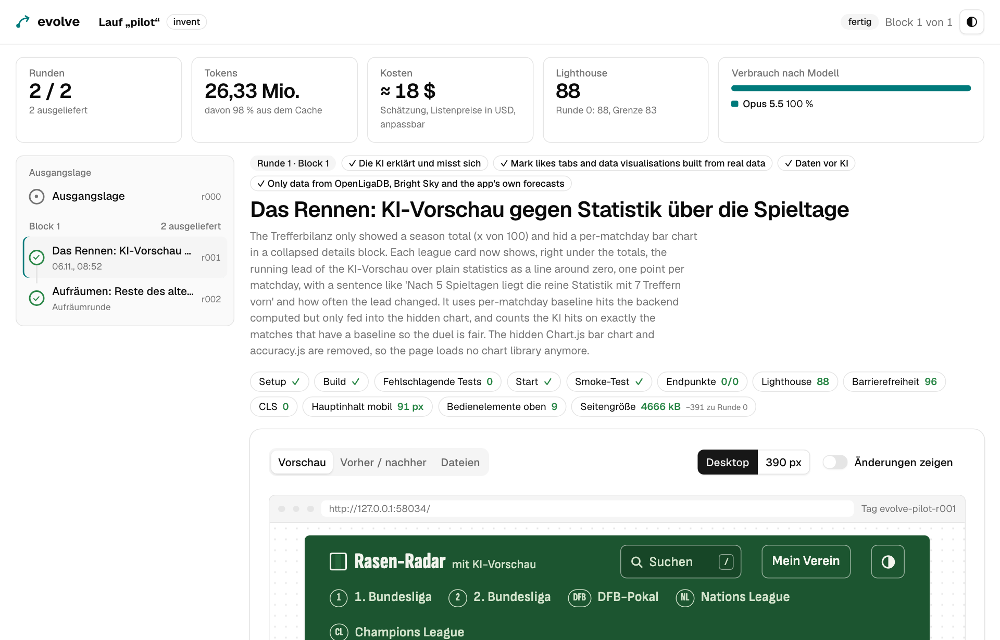

# javamark claude plugins

**From domain spec to reviewed, documented code: Claude Code plugins for Java and Quarkus developers.**

Seven plugins that work on their own and fit together: 11 skills that activate when the task matches, 15 slash commands and 7 specialist agents.

```bash
/plugin marketplace add mgoericke/javamark-claude-plugins
/plugin install sdd-toolkit@javamark-claude-plugins
```

Or run `/plugin` and browse.

## From idea to merge

Most plugins cover one step of building a feature. Use one, or walk the whole way:

| Step | You run | You get |
|------|---------|---------|
| **Specify** | `/spec` | A domain specification in plain business language, no frameworks or data types, checked by a spec reviewer |
| **Scaffold** | `/scaffold UserProfile` | A Quarkus feature in BCE architecture with Panache entities, RESTEasy Reactive endpoints and LangChain4j services, with a token budget if you want one |
| **Design the API** | just ask | An OpenAPI 3.x spec, from your domain spec or from existing Quarkus code |
| **Sketch the UI** | `/prototype` | A clickable HTML prototype for a web portal, with role-based screens |
| **Review** | `/review` | A systematic review by specialist agents for architecture, security and performance |
| **Explain** | `/adr`, `/blog` | Architecture decision records, and a technical blog post in English and German |
| **Remember** | `/wiki-save-session` | What you learned, saved as notes you can search in the next session |

## All plugins

### Build

| Plugin | What it does | Try |
|--------|--------------|-----|
| [sdd-toolkit](plugins/sdd-toolkit/) | Spec-Driven Development: write specs, derive features, get them reviewed | `/spec` |
| [quarkus-toolkit](plugins/quarkus-toolkit/) | New Quarkus features without the boilerplate, OpenAPI specs, and token budgets for AI services | `/scaffold UserProfile`, `/token-budget` |
| [frontend-toolkit](plugins/frontend-toolkit/) | Prototypes, dashboards and forms with TailAdmin, Alpine.js and Quarkus templates | `/prototype` |

### Check

| Plugin | What it does | Try |
|--------|--------------|-----|
| [review-toolkit](plugins/review-toolkit/) | Code reviews for BCE architecture, Quarkus conventions, security and test coverage | `/review` |

### Explain

| Plugin | What it does | Try |
|--------|--------------|-----|
| [doc-toolkit](plugins/doc-toolkit/) | READMEs, ADRs and blog posts straight from your project | `/adr`, `/blog` |

### Remember

| Plugin | What it does | Try |
|--------|--------------|-----|
| [wiki-llm](plugins/wiki-llm/) | A knowledge base in Obsidian that Claude writes and you read: sources become linked pages, no database | `/wiki-init`, `/wiki-ingest` |

### Experiment

| Plugin | What it does | Try |
|--------|--------------|-----|
| [evolve](plugins/evolve/) | Let Claude develop an existing app further, round by round, on its own branch | `/evolve start` |

## Spotlight: evolve

What would Claude do with your app if you let it run for a few rounds?



Each round ships one idea, or one roadmap step when behaviour must not change. Build, tests, smoke test, screenshots and metrics decide whether it stays. Every round is one commit and one tag, and the dashboard lets you open any round as a running app. evolve never pushes or merges: what reaches your product is your call.

[Read more about evolve](plugins/evolve/README.md)

## Set it up for a team

Commit this to `.claude/settings.json` and everyone gets the same plugins:

```json
{
  "extraKnownMarketplaces": {
    "javamark-claude-plugins": {
      "source": {
        "source": "url",
        "url": "https://github.com/mgoericke/javamark-claude-plugins.git"
      }
    }
  },
  "enabledPlugins": {
    "sdd-toolkit@javamark-claude-plugins": true,
    "quarkus-toolkit@javamark-claude-plugins": true
  }
}
```

Get updates with `/plugin marketplace update`.

## Contributing

Want to add a plugin? [CONTRIBUTING.md](CONTRIBUTING.md) covers the template, the plugin anatomy and versioning.

## License

[MIT](LICENSE). Third-party files bundled with evolve's dashboard keep their own licenses, see `plugins/evolve/dashboard/public/vendor/`.
